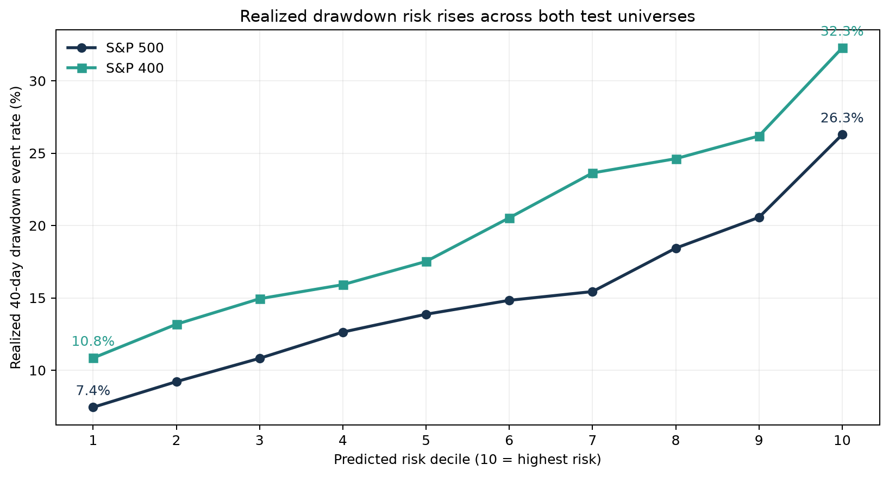
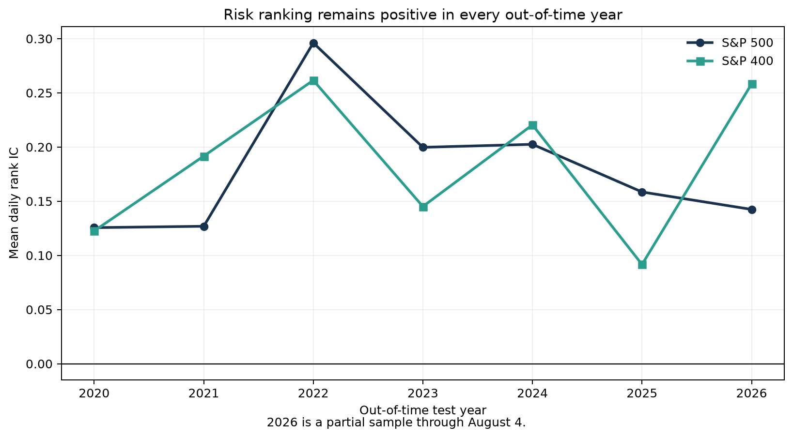
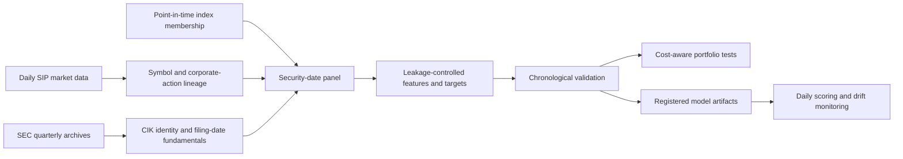

# Point-in-Time Equity Risk

[](https://github.com/agalkova/point-in-time-equity-risk/actions/workflows/tests.yml)

This project asks a practical question: **after a stock rises quickly, can we identify which stocks
are most likely to suffer a large decline next?**

I built a research pipeline that uses price, trading volume, index membership, and SEC financial
statements to estimate the risk of a stock losing at least 15% during the next 40 trading days. The
model does not try to predict an exact future price. It ranks stocks from lower to higher drawdown
risk, where a drawdown is a decline from the price observed when the prediction is made.

Identifying that risk before a decline could help investors review vulnerable positions, size
exposure more carefully, and decide when additional risk controls may be warranted.

## What the project does

1. Reconstructs which companies belonged to each index at each point in history.
2. Uses only market and financial information that was publicly available on the prediction date.
3. Trains and evaluates the model in chronological order, so future observations cannot leak into
   the past.
4. Tests the same model on later periods and on a separate group of mid-cap stocks.
5. Examines whether the risk signal improves a momentum strategy after costs and market exposure
   are considered.

The main result is that the model consistently separates higher-risk stocks from lower-risk stocks.
That result also transferred from the S&P 500 to a nearly non-overlapping S&P 400 sample. The
trading experiments did **not** establish a reliable market-beating strategy, so this is best viewed
as a drawdown-risk and financial-data-engineering project rather than a claim of proven alpha.

“Point-in-time” means that every prediction is built from the information an investor could
actually have known on that date. This matters because using today’s index members, revised company
identifiers, or financial statements before their filing dates can make a historical model look
better than it really was.

## Project origin

I started this project as a student-designed study supported by the James Rocco Quantitative Data
Research Scholarship. My original question was whether price and volume patterns could help
identify speculative equity bubbles.

Since then, I have taken the project well beyond the original study. I replaced hindsight-defined
bubble labels with forward drawdown targets, expanded the market history and investment universes,
incorporated filing-date-safe SEC fundamentals, and added leakage-controlled validation, portfolio
diagnostics, and production monitoring.

## Research question

Among stocks that gained at least 20% over the previous 60 trading days and remain within 10% of
their trailing high, can information available on the signal date rank the risk of a loss of at
least 15% during the next 40 trading days?

## Results

| Study | Sample | Main result | Conclusion |
| --- | ---: | --- | --- |
| S&P 500 out-of-time replication | 91,299 stock-date observations | 0.671 ROC AUC; 1.73× average-precision lift; 26.28% versus 7.44% event rate in the highest and lowest risk deciles | Drawdown risk is rankable out of time |
| Unchanged S&P 400 replication | 85,587 stock-date observations | 0.654 ROC AUC; 1.49× precision lift; positive rank IC in all seven years | The risk model transfers to a nearly non-overlapping universe |
| Exuberance hazard model | 8,464 episodes across three universes | 1.45×–1.57× 40-day precision lift; 18–19 trading days median warning lead time | Supports early-warning ranking, not literal bubble identification |
| SEC fundamental ablation | 34,184 out-of-fold stock-month observations | Combined long-only return of 13.16% versus 10.52% for price-only; rank-IC uplift unstable and statistically unresolved | Fundamentals are a useful research lead, not proven alpha |

The primary S&P 500 risk model produced a mean daily rank IC of 0.178 with a 40-day block-bootstrap
interval of [0.126, 0.226]. Annual risk separation was positive in every year from 2020 through the
partial 2026 sample. A risk-filtered momentum portfolio reduced volatility, beta, and maximum
drawdown, but also reduced return and market exposure. SPY buy-and-hold outperformed.

The independent S&P 400 replication used the same model and feature definitions. Average daily
overlap with the S&P 500 was 0.33%, and all frozen predictive criteria passed. The constituent
history is a pinned public reconstruction rather than licensed official index history.

## Visual summary

Realized drawdown rates increase monotonically across predicted-risk deciles in both the S&P 500
holdout and the independent S&P 400 replication.



The cross-sectional ranking remains positive in every out-of-time year for both universes, although
its strength varies with the market environment.



Full results:

- [S&P 500 replication](docs/RESULTS.md)
- [S&P 400 independent replication](docs/SP400_REPLICATION_RESULTS.md)
- [Exuberance hazard model](docs/EXUBERANCE_HAZARD_RESULTS.md)
- [SEC fundamental analysis](docs/POINT_IN_TIME_FUNDAMENTAL_RESULTS.md)
- [Production pipeline](docs/PRODUCTION_RISK_PIPELINE.md)

## System design



The pipeline uses permanent SEC CIK identifiers where accounting data is involved and dated ticker
aliases for market data. Membership changes are effective only from their recorded dates. Filings
become available on the SEC filing date, not the fiscal period end. Ambiguous joins fail closed.

## Research controls

- Point-in-time S&P 500, Nasdaq-100, and S&P 400 membership panels
- Explicit ticker-reuse and corporate-action handling
- Forward targets that exclude the signal date
- Chronological and purged walk-forward evaluation
- Frozen specifications and pass/fail rules recorded before model comparisons
- Block-bootstrap uncertainty estimates for serially dependent observations
- Transaction costs, turnover, exposure, drawdown, and six-factor attribution
- Immutable model artifacts, input hashes, drift checks, and fail-closed publication
- Automated tests for feature timing, membership timing, outcome integrity, filing timing, and
  operational idempotency

The test suite currently contains 84 tests. The SEC panel has 98.33% point-in-time issuer coverage,
97.37% fresh-filing coverage, and zero filings joined before their public date.

## Repository structure

```text
configs/                   Frozen research, data, and release specifications
data/example/              Redistribution-safe synthetic OHLCV data
docs/                      Methods, results, limitations, and operating notes
reports/                   Generated local tables and figures; excluded from Git
scripts/                   Reproducible command-line entry points
src/risk_managed_momentum/ Reusable data, feature, model, evaluation, and operations code
tests/                     Unit and end-to-end pipeline tests
```

Vendor data, derived panels, credentials, and generated reports are excluded from version control.
The public repository contains a deterministic synthetic dataset for schema and execution checks.

## Quick start

Python 3.11 or newer is required.

```bash
make install
make verify
make demo
```

`make verify` runs lint checks, all tests, the public-repository audit, and the synthetic pipeline.
`make demo` writes a local demonstration report to `reports/example/`. Synthetic metrics are not
research evidence.

Equivalent commands without `make`:

```bash
python3 -m venv .venv
source .venv/bin/activate
python -m pip install -e ".[dev]"
python -m unittest discover -s tests -v
python scripts/verify_public_repo.py
python scripts/run_example_pipeline.py --check
```

## Reproducing the SEC fundamental study

The study requires the local market, membership, identity, factor, and normalized SEC datasets
described in [Data sources](docs/DATA_SOURCES.md). Once those files are present:

```bash
make fundamentals-research
```

This command rebuilds the filing-date-safe panel and runs the frozen price-only,
fundamentals-only, and combined walk-forward comparison. Machine-readable results are written under
`reports/tables/`.

The next independent fundamental test is preregistered for the S&P 400 but has not been run. The
compact SEC history currently contains only the S&P 500 issuer set, so the quarterly archives must
be reprocessed for S&P 400 CIKs first. See the
[S&P 400 fundamental transfer plan](docs/SP400_FUNDAMENTAL_TRANSFER_PLAN.md).

## Data and credentials

Market data is retrieved from Alpaca with the SIP feed. Credentials belong in an untracked `.env`
file:

```text
APCA_API_KEY_ID=...
APCA_API_SECRET_KEY=...
```

Official SEC bulk archives require no API key. Request identity and download procedures are
documented in [Data sources](docs/DATA_SOURCES.md). Public index histories are pinned to recorded
source revisions and checksums. Their limitations are stated in the corresponding result reports.

## Selected documentation

- [Research specification](docs/RESEARCH_SPEC.md)
- [Data dictionary](docs/DATA_DICTIONARY.md)
- [Data sources and provenance](docs/DATA_SOURCES.md)
- [Decision log](docs/DECISIONS.md)
- [Progress log](docs/PROGRESS_LOG.md)
- [Prospective alpha operations](docs/PROSPECTIVE_OPERATIONS.md)
- [Resume bullets](docs/RESUME_BULLETS.md)

## Scope of the claims

This repository supports three claims:

1. Severe post-run-up drawdown risk can be ranked out of time.
2. The frozen risk model transferred to a nearly non-overlapping mid-cap universe.
3. A point-in-time SEC pipeline can evaluate accounting signals without ticker-only joins or filing
   date leakage.

It does not support claims of reliable bubble identification, market-neutral alpha, or production
trading profitability.
