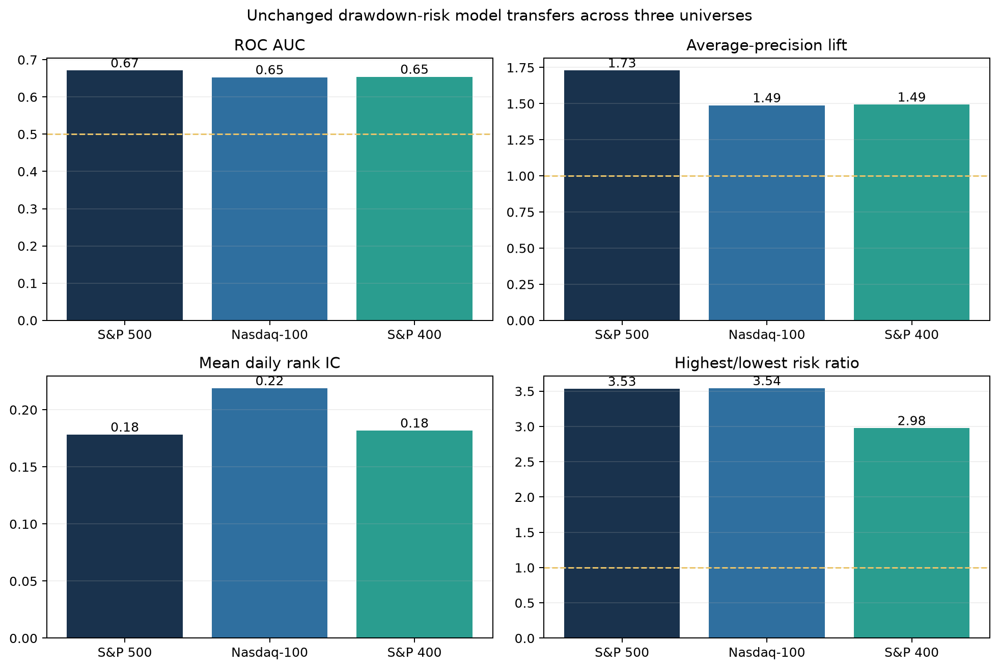
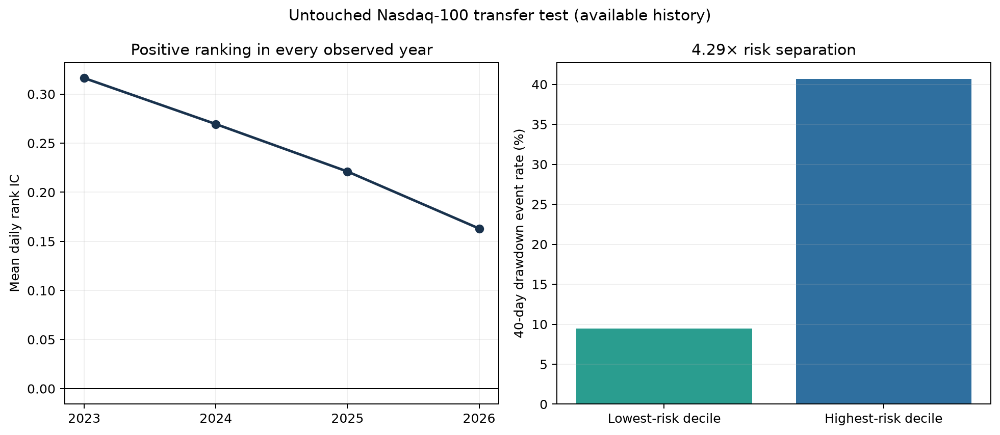
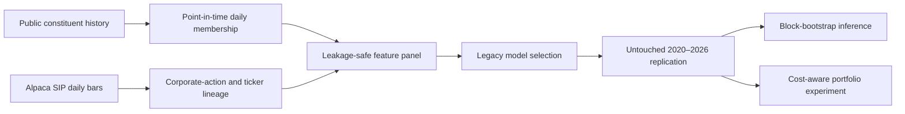

# Risk-Managed Momentum

Research and engineering project for forecasting severe drawdowns after strong equity price run-ups.

## Research question

Among stocks that gained at least 20% over the previous 60 trading days and remain within 10% of their trailing high, can information available on the signal date rank the risk of a severe loss during the next 40 trading days?

The project combines three deliverables:

1. A point-in-time equity data pipeline.
2. A leakage-controlled cross-sectional drawdown-risk model.
3. A transaction-cost-aware risk-managed momentum portfolio experiment.

## Result

The untouched 2020–2026 replication supports a real drawdown-risk ranking signal:

- 91,299 eligible stock-date observations and 13,688 drawdown events.
- ROC AUC: **0.671**; average-precision lift: **1.73×**.
- Highest-risk-decile event rate: **26.28%** versus **7.44%** in the lowest decile.
- Mean daily rank IC: **0.178**, with 40-day block-bootstrap interval **[0.126, 0.226]**.
- Positive annual risk separation in every year from 2020 through the partial 2026 sample.

The portfolio result is deliberately more restrained. Validation selected no risk penalty for
the return-ranking model. A monthly highest-risk-quintile exclusion reduced volatility,
beta, and maximum drawdown after costs, but also reduced return and market exposure. SPY
buy-and-hold outperformed. The defensible claim is **risk ranking**, not bubble prediction or
alpha generation.


Full interpretation, baselines, annual results, portfolio results, and limitations are in
[docs/RESULTS.md](docs/RESULTS.md).

### Corrected bubble-detection model

Version 0.9 returns to the original project idea without the hindsight-defined labels. It detects
the start of a measurable **exuberance episode**, then estimates a monotonic drawdown-risk curve
over 10, 20, 40, and 60 trading days using one interpretable discrete-time hazard model.

Across 8,464 modern episodes in the S&P 500, Nasdaq-100, and S&P 400, the 40-day model achieved
0.618–0.628 ROC AUC and 1.45×–1.57× average-precision lift. Highest-risk-quintile episodes had
2.45×–3.50× the drawdown rate of the lowest quintile, with 18–19 trading days of median warning
lead time. It beat trailing run-up strength alone in all three universes. Absolute probabilities
remain under-calibrated after the legacy-to-modern base-rate shift, so the supported claim is
transferable early-warning ranking—not literal bubble identification or proven alpha.

See [docs/EXUBERANCE_HAZARD_RESULTS.md](docs/EXUBERANCE_HAZARD_RESULTS.md) for the corrected
framing, full horizon results, drivers, limitations, and reproduction instructions.


A frozen follow-up tested walk-forward intercept recalibration and a high-risk episode exclusion
portfolio. Recalibration overshot changing regimes and worsened Brier score in all three
universes. The overlay reduced volatility and maximum drawdown everywhere, but also reduced
return and Sharpe everywhere. Both extensions were rejected under their precommitted rules.
See [docs/CALIBRATED_OVERLAY_RESULTS.md](docs/CALIBRATED_OVERLAY_RESULTS.md).

### Independent mid-cap replication

The strongest transfer test applies the unchanged model to a point-in-time S&P 400 MidCap panel
with only **0.33% average daily overlap** with the S&P 500. Across 85,587 eligible observations,
the model achieved **0.654 ROC AUC**, **1.49× average-precision lift**, a **2.98×**
highest/lowest-risk-decile event ratio, and **0.182** mean daily rank IC with block interval
**[0.146, 0.219]**. Annual rank IC was positive in all seven years. Both data-quality gates and
all five frozen predictive criteria passed.

The free membership history is a pinned public reconstruction rather than licensed official S&P
data. Full provenance, coverage recovery, annual results, and limitations are documented in
[docs/SP400_REPLICATION_RESULTS.md](docs/SP400_REPLICATION_RESULTS.md).



## Advanced research layer

An exploratory v0.2 layer adds 31 features, seven purged yearly walk-forward tests,
logistic and gradient-boosted models, a fixed ensemble, calibration diagnostics,
non-overlapping event evaluation, feature importance, and a cash-matched portfolio test.
The ensemble modestly improves probabilistic ranking, but a transparent four-factor score
remains competitive. More importantly, the risk filter does **not** beat ordinary momentum
after matching cash exposure. This strengthens the research process without overstating a
trading result.

See [docs/ADVANCED_RESULTS.md](docs/ADVANCED_RESULTS.md) for the full comparison.

## Exploratory alpha study

Version 0.3 separately predicts beta-adjusted future returns across the full point-in-time
universe. The primary ensemble failed to produce alpha. A simpler ridge model subsequently
showed a promising top-50 portfolio—21.34% annual return after modeled costs, 1.19 Sharpe,
and 5.48% estimated annual six-factor alpha—but its alpha t-statistic was only 1.46 and the
portfolio mapping was inspected after the primary result. It is therefore frozen as a
**prospective candidate**, not reported as proven alpha.

See [docs/ALPHA_RESULTS.md](docs/ALPHA_RESULTS.md) and the prospective rules in
[docs/PROSPECTIVE_SPEC_V0_4.md](docs/PROSPECTIVE_SPEC_V0_4.md).

### Nasdaq-100 transfer test

An unchanged-model cross-universe test applied the legacy-selected drawdown-risk model to a
point-in-time Nasdaq-100 panel from 2020 through 2026. It achieved **0.653 ROC AUC**, **1.49×
average-precision lift**, and a **3.54×** highest- versus lowest-risk-decile event ratio. Mean
daily rank IC was **0.219** with a 40-day block interval of **[0.162, 0.271]**, and annual rank IC
was positive in all seven years. The result passed every pre-specified full-universe threshold.

This is supportive transfer evidence, not a fully independent-security confirmation: average
NDX/S&P 500 overlap was 81.5%, and the non-S&P subset diagnostic was mixed. The free constituent
history is a pinned community reconstruction validated against 39 independently retrieved PtData
snapshots; it is not licensed official index history.
See [docs/NDX_REPLICATION_STATUS.md](docs/NDX_REPLICATION_STATUS.md).



### Portfolio engineering and prospective record

A frozen constrained-optimization experiment did not improve the ridge candidate: annual return
fell from 21.34% to 13.97%, Sharpe fell from 1.19 to 0.81, and maximum drawdown worsened. The
optimizer was rejected without post-result tuning. See
[docs/PORTFOLIO_ENGINEERING_RESULTS.md](docs/PORTFOLIO_ENGINEERING_RESULTS.md).

The original equal-weight ridge top-50 rule therefore remains the sole prospective candidate.
Immutable signal snapshots, content hashes, turnover, cost, and training cutoffs are managed by
`generate_prospective_alpha_candidate.py`; operating rules are in
[docs/PROSPECTIVE_OPERATIONS.md](docs/PROSPECTIVE_OPERATIONS.md).

## Research design



The pipeline fails closed on ambiguous symbol joins. That check caught a reused ticker and
prevented an unrelated company's history from entering the holdout.

## Repository structure

```text
configs/                  Frozen research and data settings
data/                     Local data layers; contents are excluded from Git
docs/                     Specification, decisions, progress, and data definitions
reports/                  Generated tables and figures
scripts/                  Command-line entry points
src/risk_managed_momentum Reusable pipeline and research code
tests/                    Timing, target, and data-contract tests
```

## Quick start

Create an environment and install the project:

```bash
python -m venv .venv
source .venv/bin/activate
python -m pip install -e ".[dev]"
```

Run the tests:

```bash
python -m unittest discover -s tests -v
```

Run the legacy source audit:

```bash
python scripts/audit_legacy_data.py
```

The original non-redistributable legacy price and volume files belong under
`data/external/legacy/` using the filenames in `configs/research.toml`. Their locations can
instead be supplied through `RMM_LEGACY_PRICE_PATH` and `RMM_LEGACY_VOLUME_PATH`. No
machine-specific path is committed.

Reproduce the frozen legacy feasibility result:

```bash
python scripts/run_legacy_feasibility.py
```

Build the point-in-time membership history:

```bash
python scripts/build_sp500_membership.py --start 2019-06-01 --end 2026-09-30
```

Create a private `.env` file in the project root (it is excluded from Git):

```text
APCA_API_KEY_ID=...
APCA_API_SECRET_KEY=...
```

Then run a download:

```bash
python scripts/download_alpaca.py --symbols-file data/reference/pilot_symbols.txt \
  --start 2016-01-01 --end 2019-06-12
```

The downloader explicitly requests the `sip` feed. It refuses to continue if the response cannot be identified as the requested historical source.

After downloading both `raw` and `all` adjustment variants for the reconciliation period:

```bash
python scripts/reconcile_overlap.py \
  --raw-bars data/raw/alpaca/bars_2016-01-01_2019-06-12_raw.csv.gz \
  --adjusted-bars data/raw/alpaca/bars_2016-01-01_2019-06-12_all.csv.gz
```

The audit compares price levels, daily returns, consolidated volume, coverage dates, and symbol mappings for each pilot security.

The completed pilot retrieved 16,810 overlapping observations across all 20 requested
securities, including renamed and delisted names. Results support raw close as the closest
match to the legacy price level, while adjusted returns are retained as a candidate for
economically meaningful return features. See `docs/DATA_SOURCES.md` for the reconciliation
summary and limitations.

After the documented data downloads, reproduce the modern research outputs:

```bash
python scripts/download_historical_aliases.py
python scripts/run_modern_replication.py
python scripts/run_portfolio_experiment.py
python scripts/run_advanced_walk_forward.py
python scripts/run_exposure_matched_portfolio.py
python scripts/download_fama_french_factors.py
python scripts/run_alpha_research.py
python scripts/run_alpha_sensitivity.py
python scripts/run_optimized_alpha_portfolio.py
python scripts/generate_prospective_alpha_candidate.py
python scripts/run_exuberance_hazard.py
python scripts/run_calibrated_overlay.py
python scripts/make_figures.py
```

### SEC fundamentals proof of concept

Version 0.5 tests whether filing-date-safe annual fundamentals add ranking information to the
existing price model. Set a descriptive SEC request identity locally; it is never saved:

```bash
export SEC_USER_AGENT="Your Name your-email@example.com"
python scripts/download_sec_fundamentals.py
python scripts/run_fundamental_pilot.py
```

If the SEC returns HTTP 403, use the documented no-key point-in-time fallback:

```bash
python scripts/download_ptdata_fundamentals.py
python scripts/run_fundamental_pilot.py
```

The pilot intentionally uses only about 22 issuers and begins from today's constituent list,
so its portfolio results are diagnostic rather than investable evidence. Its frozen design and
expansion criteria are in
[docs/RESEARCH_SPEC_V0_5_FUNDAMENTALS.md](docs/RESEARCH_SPEC_V0_5_FUNDAMENTALS.md).

The completed pilot found a small, statistically inconclusive rank-IC improvement and materially
worse concentrated portfolio performance. The feature set was rejected rather than tuned after
inspection. See [docs/FUNDAMENTAL_RESULTS.md](docs/FUNDAMENTAL_RESULTS.md).

## Research controls

The primary eligibility rule, outcome, time splits, metrics, and modern holdout policy are defined in [docs/RESEARCH_SPEC.md](docs/RESEARCH_SPEC.md). Any change must be recorded in [docs/DECISIONS.md](docs/DECISIONS.md) before the modern holdout is evaluated.

Raw vendor data and API credentials must never be committed. The repository includes
reproducible download code, schemas, validation summaries, and a small redistribution-safe
synthetic example dataset.

## Portfolio value

This repository demonstrates three job-relevant capabilities together:

- **Quantitative research:** forward labels, chronological model selection, factor baselines,
  regime reporting, block-bootstrap uncertainty, and transaction-cost-aware simulation.
- **Data engineering:** authenticated paginated ingestion, manifests, data contracts,
  point-in-time membership reconstruction, and dated corporate-action mappings.
- **Research judgment:** leakage controls, an untouched holdout, explicit negative results,
  and claims calibrated to evidence.

Suggested resume language is in [docs/RESUME_BULLETS.md](docs/RESUME_BULLETS.md).

## Status

See [docs/PROGRESS_LOG.md](docs/PROGRESS_LOG.md) for completed work and the next action.

