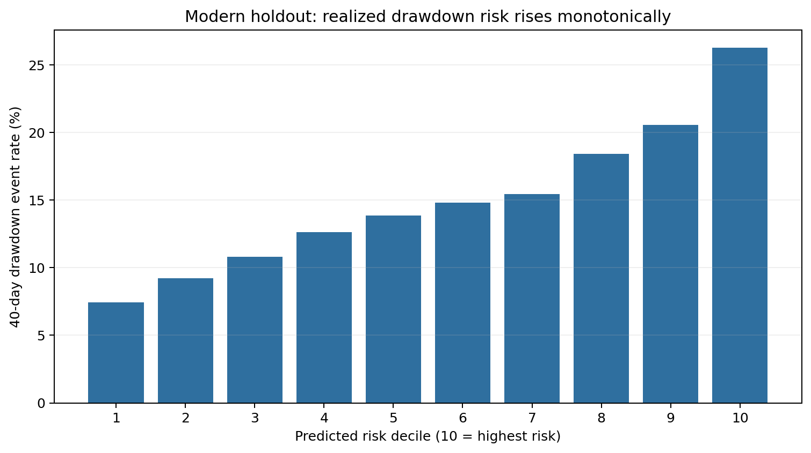
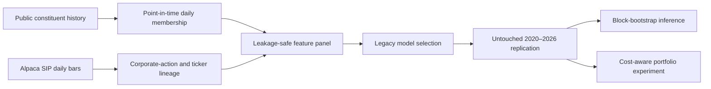

# Risk-Managed Momentum

Research and engineering project for forecasting severe drawdowns after strong equity price run-ups.

## Research question

Among stocks that gained at least 20% over the previous 60 trading days and remain within 10% of their trailing high, can information available on the signal date rank the risk of a severe loss during the next 40 trading days?

The project combines three deliverables:

1. A point-in-time equity data pipeline.
2. A leakage-controlled cross-sectional drawdown-risk model.
3. A transaction-cost-aware risk-managed momentum portfolio experiment.

## Result

The untouched 2020–2026 replication supports a real drawdown-risk ranking signal:

- 91,299 eligible stock-date observations and 13,688 drawdown events.
- ROC AUC: **0.671**; average-precision lift: **1.73×**.
- Highest-risk-decile event rate: **26.28%** versus **7.44%** in the lowest decile.
- Mean daily rank IC: **0.178**, with 40-day block-bootstrap interval **[0.126, 0.226]**.
- Positive annual risk separation in every year from 2020 through the partial 2026 sample.

The portfolio result is deliberately more restrained. Validation selected no risk penalty for
the return-ranking model. A monthly highest-risk-quintile exclusion reduced volatility,
beta, and maximum drawdown after costs, but also reduced return and market exposure. SPY
buy-and-hold outperformed. The defensible claim is **risk ranking**, not bubble prediction or
alpha generation.



Full interpretation, baselines, annual results, portfolio results, and limitations are in
[docs/RESULTS.md](docs/RESULTS.md).

## Research design



The pipeline fails closed on ambiguous symbol joins. That check caught a reused ticker and
prevented an unrelated company's history from entering the holdout.

## Repository structure

```text
configs/                  Frozen research and data settings
data/                     Local data layers; contents are excluded from Git
docs/                     Specification, decisions, progress, and data definitions
reports/                  Generated tables and figures
scripts/                  Command-line entry points
src/risk_managed_momentum Reusable pipeline and research code
tests/                    Timing, target, and data-contract tests
```

## Quick start

Create an environment and install the project:

```bash
python -m venv .venv
source .venv/bin/activate
python -m pip install -e ".[dev]"
```

Run the tests:

```bash
python -m unittest discover -s tests -v
```

Run the legacy source audit:

```bash
python scripts/audit_legacy_data.py
```

The original non-redistributable legacy price and volume files belong under
`data/external/legacy/` using the filenames in `configs/research.toml`. Their locations can
instead be supplied through `RMM_LEGACY_PRICE_PATH` and `RMM_LEGACY_VOLUME_PATH`. No
machine-specific path is committed.

Reproduce the frozen legacy feasibility result:

```bash
python scripts/run_legacy_feasibility.py
```

Build the point-in-time membership history:

```bash
python scripts/build_sp500_membership.py --start 2019-06-01 --end 2026-09-30
```

Create a private `.env` file in the project root (it is excluded from Git):

```text
APCA_API_KEY_ID=...
APCA_API_SECRET_KEY=...
```

Then run a download:

```bash
python scripts/download_alpaca.py --symbols-file data/reference/pilot_symbols.txt \
  --start 2016-01-01 --end 2019-06-12
```

The downloader explicitly requests the `sip` feed. It refuses to continue if the response cannot be identified as the requested historical source.

After downloading both `raw` and `all` adjustment variants for the reconciliation period:

```bash
python scripts/reconcile_overlap.py \
  --raw-bars data/raw/alpaca/bars_2016-01-01_2019-06-12_raw.csv.gz \
  --adjusted-bars data/raw/alpaca/bars_2016-01-01_2019-06-12_all.csv.gz
```

The audit compares price levels, daily returns, consolidated volume, coverage dates, and symbol mappings for each pilot security.

The completed pilot retrieved 16,810 overlapping observations across all 20 requested
securities, including renamed and delisted names. Results support raw close as the closest
match to the legacy price level, while adjusted returns are retained as a candidate for
economically meaningful return features. See `docs/DATA_SOURCES.md` for the reconciliation
summary and limitations.

After the documented data downloads, reproduce the modern research outputs:

```bash
python scripts/download_historical_aliases.py
python scripts/run_modern_replication.py
python scripts/run_portfolio_experiment.py
python scripts/make_figures.py
```

## Research controls

The primary eligibility rule, outcome, time splits, metrics, and modern holdout policy are defined in [docs/RESEARCH_SPEC.md](docs/RESEARCH_SPEC.md). Any change must be recorded in [docs/DECISIONS.md](docs/DECISIONS.md) before the modern holdout is evaluated.

Raw vendor data and API credentials must never be committed. The repository includes
reproducible download code, schemas, validation summaries, and a small redistribution-safe
synthetic example dataset.

## Portfolio value

This repository demonstrates three job-relevant capabilities together:

- **Quantitative research:** forward labels, chronological model selection, factor baselines,
  regime reporting, block-bootstrap uncertainty, and transaction-cost-aware simulation.
- **Data engineering:** authenticated paginated ingestion, manifests, data contracts,
  point-in-time membership reconstruction, and dated corporate-action mappings.
- **Research judgment:** leakage controls, an untouched holdout, explicit negative results,
  and claims calibrated to evidence.

Suggested resume language is in [docs/RESUME_BULLETS.md](docs/RESUME_BULLETS.md).

## Status

See [docs/PROGRESS_LOG.md](docs/PROGRESS_LOG.md) for completed work and the next action.

