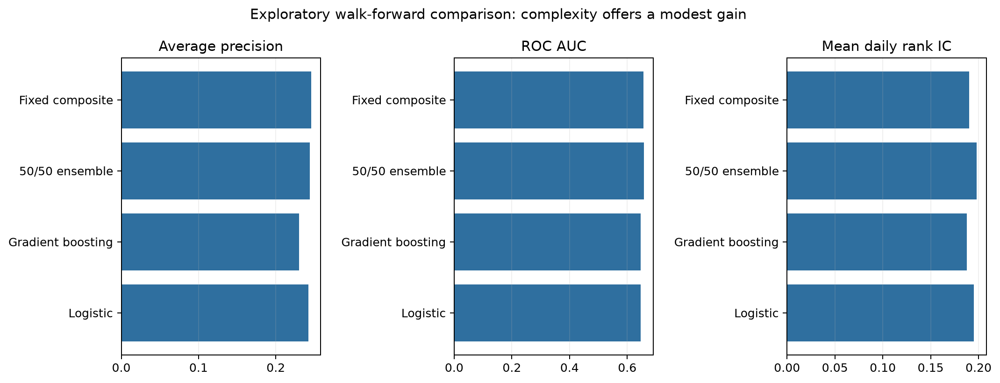
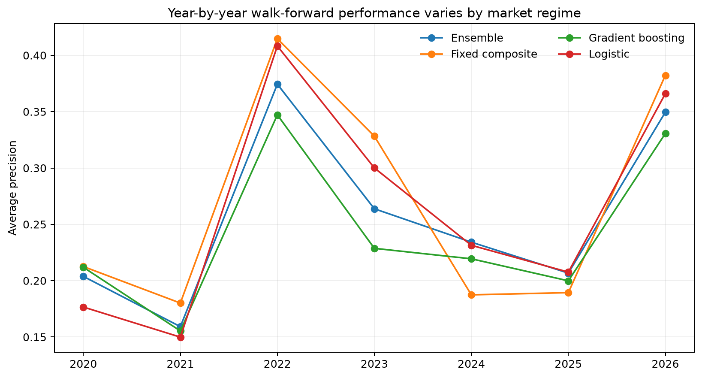
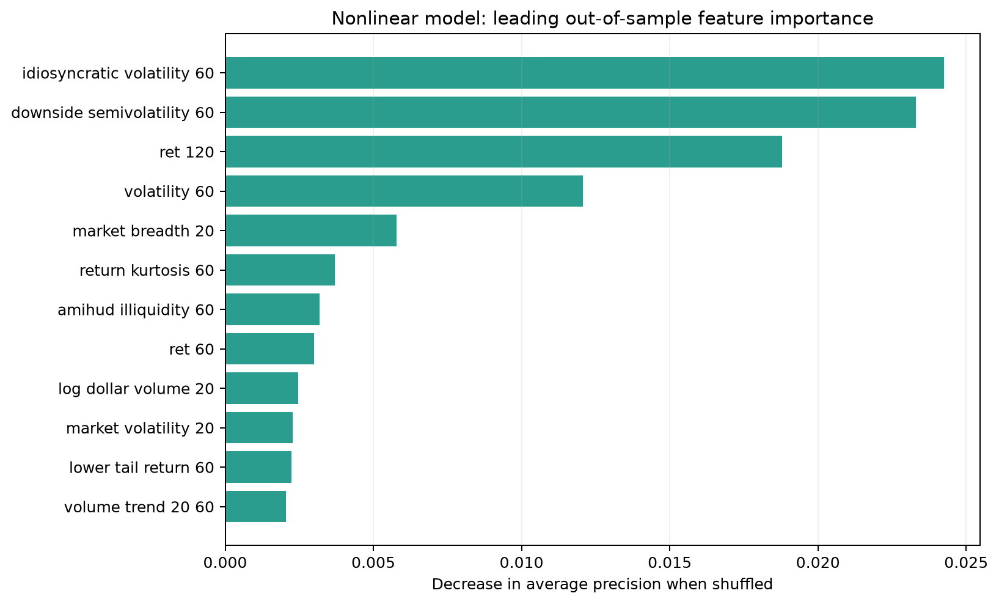
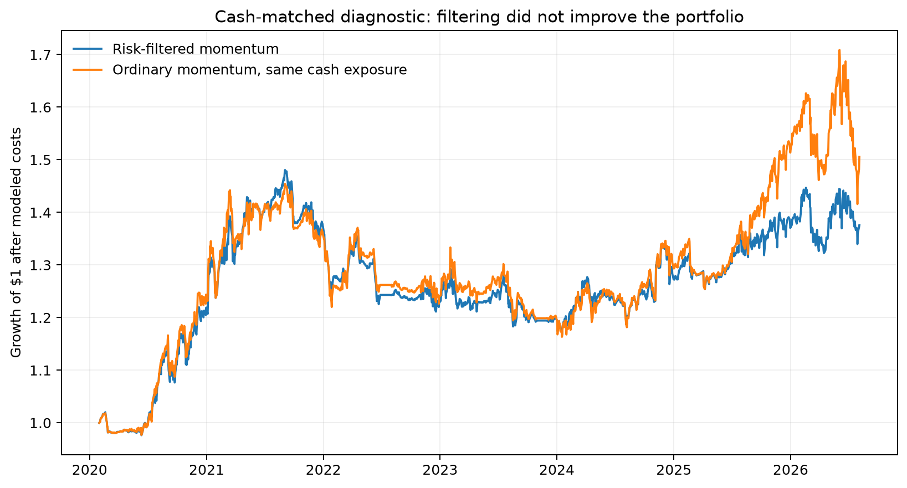

# Advanced research results (v0.2 exploratory)

## Why this layer exists

Version 0.1 remains the frozen confirmatory result. Version 0.2 asks whether a more
institutional research workflow changes the conclusion. It adds 31 price, volume,
liquidity, downside-risk, and market-state features; expanding yearly walk-forward folds;
a 40-trading-day purge; probability calibration; non-overlapping event evaluation; a
nonlinear model; and a cash-matched portfolio diagnostic.

Because the 2020–2026 period had already been examined before v0.2 was specified, these
results are explicitly **exploratory**, not a second untouched holdout.

## Walk-forward model comparison

All 91,299 modern observations receive predictions from models trained only on earlier
data. The reported scores pool seven out-of-fold calendar-year tests.

| Score | Average precision | AP lift | ROC AUC | Mean daily rank IC | Top-bottom event-rate spread |
|---|---:|---:|---:|---:|---:|
| Logistic regression | 0.242 | 1.61x | 0.647 | 0.195 | 17.65 pp |
| Histogram gradient boosting | 0.230 | 1.54x | 0.646 | 0.188 | 18.34 pp |
| Fixed 50/50 ensemble | 0.244 | 1.63x | **0.658** | **0.198** | 18.27 pp |
| Transparent fixed composite | **0.246** | **1.64x** | 0.657 | 0.190 | **20.48 pp** |

The ensemble gives the best probabilistic discrimination and calibration of the fitted
models. However, the transparent four-factor composite is essentially tied and produces
the strongest decile separation. Gradient boosting alone does not beat the simpler
alternatives. That is a useful quant result: the better research process adds confidence,
but extra model complexity does not create a dramatic edge.

Performance changes materially by year. The fixed composite leads in 2020–2023 and the
partial 2026 sample, while fitted models are more competitive in 2024–2025. No model wins
in every regime.

## Independent-event and lead-time check

Daily labels overlap heavily because each signal looks forward 40 trading days. A greedy
per-security thinning rule reduces the evaluation to 5,695 non-overlapping signal windows,
including 989 drawdown events. Warning thresholds are formed in the full same-day
cross-section before thinning.

The ensemble's independent-event average precision is about 0.274, versus 0.174 event
prevalence. Its highest-risk-quintile warnings identify roughly 35% of events at 29%
precision, with a median first-breach lead time of 19 trading days. The fixed composite is
similarly effective. This makes the output more interpretable as an early-warning rank,
while still falling far short of a deterministic crash alarm.

## What the nonlinear model learned

Permutation importance on the last walk-forward fold places idiosyncratic volatility,
downside semivolatility, 120-day return, 60-day volatility, and market breadth at the top.
Liquidity, return-tail shape, recent momentum, and market volatility add smaller amounts.

## Cash-matched portfolio diagnostic

The original defensive portfolio held more cash than ordinary momentum, so part of its
lower volatility was mechanical. Version 0.2 uses walk-forward out-of-fold risk scores and
scales the ordinary momentum return stream to the risk filter's realized daily gross
exposure. Both series include 10 basis points of one-way modeled cost.

| Monthly strategy | Annual return | Annual volatility | Sharpe | Maximum drawdown | Average exposure |
|---|---:|---:|---:|---:|---:|
| Risk-filtered momentum | 5.04% | 10.81% | 0.47 | -21.20% | 53.70% |
| Ordinary momentum, same cash exposure | **6.51%** | 12.84% | **0.51** | **-20.00%** | 53.70% |

The filter does not improve the cash-matched portfolio: return and Sharpe are lower, and
maximum drawdown is slightly worse. Therefore the research supports a **cross-sectional
drawdown-risk signal**, not a profitable standalone trading strategy.

## Limitations and next valid test

- S&P 500 membership is reconstructed from public change history rather than a licensed
  security-master database.
- Historical point-in-time sector classifications are still unavailable, so no sector
  neutralization claim is made.
- The v0.2 model comparison is exploratory because its test years were already visible.
- Portfolio results remain a simplified long-only simulation without market impact,
  borrow constraints, tax effects, or execution modeling.
- The next confirmatory test must use genuinely unseen future data or a separately frozen
  universe and period. Repeated tuning on 2020–2026 would not count as validation.
