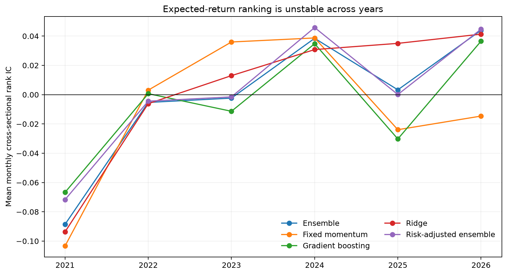
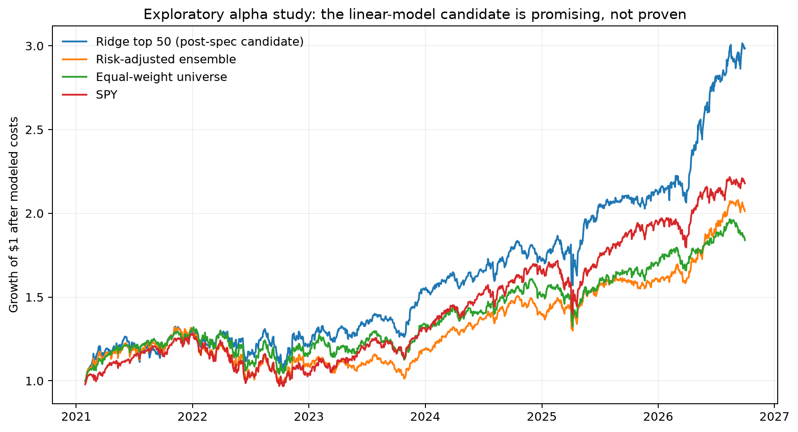
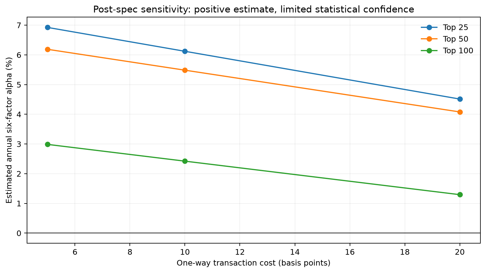

# Exploratory alpha study (v0.3)

## Bottom line

The pre-specified primary ensemble did **not** produce alpha. A simpler ridge-regression
portfolio examined as a post-specification diagnostic is promising enough to freeze for
prospective testing, but it is not statistically strong enough to call proven alpha.

This distinction matters. The project now contains both an alpha candidate and the controls
needed to prevent a good historical chart from being presented as investment skill.

## Research design

- Full point-in-time S&P 500 universe rather than only recent 20% run-ups.
- Monthly signals and next-21-trading-day beta-adjusted return targets.
- 22 price, residual-momentum, risk, volume, liquidity, and market-state features.
- Expanding yearly walk-forward predictions for 2021–2026.
- One month-end purge between each training and test period.
- 33,598 out-of-fold security-month observations across 68 months.
- Monthly rebalancing with 10 basis points of one-way modeled costs.
- Six-factor attribution using market, size, value, profitability, investment, and momentum.

## Predictive results

| Score | Mean monthly rank IC | 95% block interval | Top-bottom residual-return spread |
|---|---:|---:|---:|
| Ridge regression | 0.001 | [-0.033, 0.037] | 0.48% per month |
| Gradient boosting | -0.009 | [-0.038, 0.020] | 0.01% per month |
| Fixed ensemble | -0.004 | [-0.038, 0.030] | 0.26% per month |
| Fixed momentum composite | -0.010 | [-0.044, 0.025] | -0.28% per month |
| Risk-adjusted ensemble | -0.000 | [-0.032, 0.035] | 0.44% per month |

None of the rank-IC confidence intervals excludes zero. Ridge regression shows an
interesting extreme-decile spread, but it does not rank the entire cross-section reliably.
Gradient boosting adds complexity without improving the signal.

## Pre-specified portfolio results

| Portfolio | Annual return | Volatility | Sharpe | Maximum drawdown | Six-factor alpha | Alpha t-stat |
|---|---:|---:|---:|---:|---:|---:|
| Primary ensemble, top 50 | 12.31% | 18.11% | 0.68 | -28.96% | -1.12% | -0.32 |
| Risk-adjusted ensemble, top 50 | 13.18% | 16.28% | 0.81 | -25.54% | 0.80% | 0.23 |
| Equal-weight universe | 11.39% | 15.87% | 0.72 | -21.25% | -0.86% | -0.53 |
| SPY buy-and-hold | **14.78%** | 16.67% | **0.89** | -24.50% | 0.22% | 0.50 |
| Ensemble long-short | 0.23% | 7.40% | 0.03 | -18.74% | -0.71% | -0.27 |

The primary ensemble fails the alpha standard. The drawdown penalty improves the ensemble's
risk-adjusted result, but it still trails SPY and its factor-adjusted intercept is
indistinguishable from zero.

## Post-specification ridge candidate

After the primary result was opened, each already-defined component model was mapped to the
same portfolio rule as a sensitivity diagnostic. The ridge model produced the strongest
historical portfolio:

| Ridge top-50 portfolio | Result |
|---|---:|
| Annual return after modeled costs | 21.34% |
| Annualized volatility | 17.94% |
| Sharpe ratio | 1.19 |
| Maximum drawdown | -18.83% |
| SPY annual return over the same simulation | 14.78% |
| Estimated annual six-factor alpha | 5.48% |
| HAC alpha t-statistic | 1.46 |
| Positive calendar years | 5 of 6 |

The corresponding market-neutral long-short portfolio returned 4.72% annually, had near-zero
market beta, and produced estimated factor alpha of 3.23% with a 1.16 t-statistic.

The result remains economically positive across 25, 50, and 100 positions and transaction
cost assumptions from 5 to 20 basis points. However, no sensitivity variant reaches an alpha
t-statistic of 2.0. The top-50 result was inspected after the primary ensemble failed, so its
historical performance is hypothesis-generating evidence—not confirmation.

## Correct conclusion

The project has found a **prospective alpha candidate**, not established alpha. The valid
next action is to freeze the ridge model, top-50 construction, monthly schedule, and costs;
then record every future signal without further tuning. Sector neutrality and realistic
short-borrow assumptions remain important missing controls. The liquidity screen is also
constructed from fully adjusted vendor bars and may not exactly reproduce contemporaneous
historical price-level eligibility around later corporate actions.
