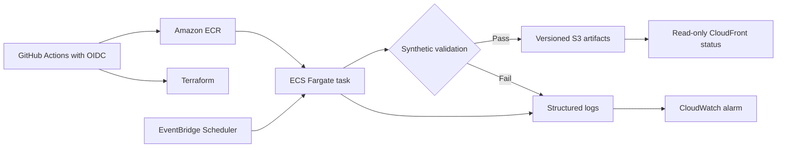

# AWS synthetic deployment

## Scope

The cloud workload runs only the deterministic public synthetic demonstration. It does not upload
licensed market data, research outputs, API credentials, or live investment signals. The purpose is
to demonstrate containerization, infrastructure as code, short-lived CI credentials, scheduled
batch execution, immutable artifact publication, and operational monitoring.

## Architecture



The Fargate task runs without inbound network access. Its runtime IAM role can read and write only
the synthetic artifact prefix. The S3 bucket is private and encrypted; CloudFront receives read-only
access through Origin Access Control. The image tag and research artifacts are immutable.

## Local container

```bash
docker build -t point-in-time-equity-risk:local .
docker run --rm --read-only \
  --mount type=volume,destination=/app/output \
  point-in-time-equity-risk:local
```

The process exits nonzero when validation or publication fails. With no `ARTIFACT_BUCKET`, it writes
the bundle locally and explicitly records that cloud publication was skipped.

## One-time AWS bootstrap

The bootstrap creates the encrypted Terraform state bucket, GitHub OIDC provider, and deployment
role. It must be run once with an existing AWS administrator identity:

```bash
cd infra/bootstrap
terraform init
terraform apply
```

If the account already has GitHub's OIDC provider, import it before applying rather than creating a
duplicate:

```bash
terraform import aws_iam_openid_connect_provider.github \
  arn:aws:iam::<account-id>:oidc-provider/token.actions.githubusercontent.com
```

Save the three outputs as GitHub repository variables:

| Terraform output | GitHub variable |
|---|---|
| `github_deploy_role_arn` | `AWS_DEPLOY_ROLE_ARN` |
| `terraform_state_bucket` | `TF_STATE_BUCKET` |
| `aws_region` | `AWS_REGION` |

Create a protected GitHub environment named `production`. The OIDC trust policy accepts only jobs
from that environment. No permanent AWS access key is stored in GitHub.

Optionally add `ALERT_EMAIL` as a GitHub environment secret. AWS sends a confirmation message before
the SNS subscription becomes active. The same address receives the forecast budget notification.

## Deployment

Run **deploy synthetic AWS workload** from GitHub Actions. The workflow:

1. assumes the deployment role through OIDC;
2. creates or updates the reviewed Terraform resources with scheduling disabled;
3. builds the container and fails on fixable high or critical Trivy findings;
4. pushes an immutable commit-tagged image to ECR;
5. refreshes the task definition while keeping the schedule disabled;
6. starts one Fargate smoke-test task;
7. checks its exit code and verifies the expected S3 manifest;
8. enables the schedule only after the smoke test passes, when requested;
9. prints the status URL in the workflow summary.

The default schedule is 23:15 UTC on weekdays. It runs the synthetic proof, not the private market
pipeline. Change the schedule through Terraform rather than the AWS console.

## Artifact contract

Each run publishes:

```text
synthetic/runs/<deterministic-run-id>/
├── health.json
├── manifest.json
└── summary.json
```

The run ID contains the UTC date, synthetic-input hash, and deployment commit. An identical same-day
retry verifies and reuses the existing objects. A retry that produces different bytes fails instead
of overwriting evidence. `synthetic/status/latest.json` is a small pointer used by the public status
page.

## Cost and teardown

The demonstration uses Fargate only while a task is running and avoids NAT gateways. ECR, S3,
CloudWatch, CloudFront, and AWS Budgets may still incur charges. Review AWS billing before applying.

Terraform will not delete a non-empty artifact bucket by default. For a disposable environment,
explicitly set `allow_destroy_artifacts = true`, then run:

```bash
terraform destroy -var="allow_destroy_artifacts=true"
```

The bootstrap state bucket has `prevent_destroy`; preserve it unless the AWS account is being
deliberately decommissioned.
