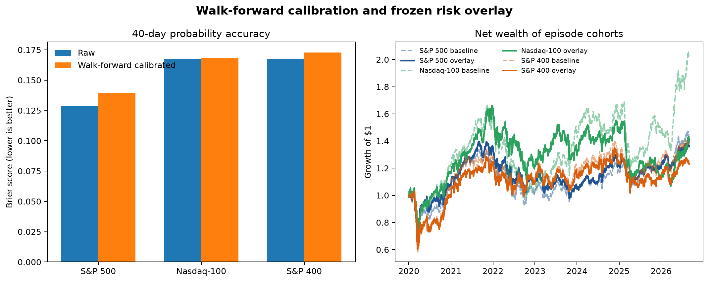

# Walk-forward calibration and frozen risk-overlay results

## Outcome

Neither frozen v1.0 decision rule passed. The result narrows the project’s claim rather than replacing the successful v0.9 ranking evidence.

- **Recalibration:** rejected. It did not improve both Brier score and log loss in any universe.
- **Portfolio overlay:** rejected. It reduced maximum drawdown in every universe but lowered net Sharpe ratio and annual return in every universe.
- **Model status:** retain the v0.9 score as a relative fragility rank. Do not present its raw or recalibrated output as a reliable absolute probability, and do not present its high-risk exclusion as alpha.

The v1.0 specification and implementation were committed before these results were generated. No thresholds or rules were changed afterward.

## Walk-forward probability recalibration

Each test year from 2021 onward received one fixed-slope logit-intercept adjustment estimated from fully matured prior episodes in the same universe. The underlying model and within-year ordering were unchanged.

### Forty-day probability results, 2021–2026

| Universe | Score | Mean prediction | Event rate | Brier | Log loss | ROC AUC |
|---|---|---:|---:|---:|---:|---:|
| S&P 500 | Raw | 9.77% | 15.69% | 0.1285 | 0.4272 | 0.674 |
| S&P 500 | Recalibrated | 23.92% | 15.69% | 0.1394 | 0.4428 | 0.661 |
| Nasdaq-100 | Raw | 11.17% | 20.79% | 0.1673 | 0.5414 | 0.629 |
| Nasdaq-100 | Recalibrated | 24.45% | 20.79% | 0.1682 | 0.5198 | 0.605 |
| S&P 400 | Raw | 9.98% | 20.76% | 0.1675 | 0.5388 | 0.668 |
| S&P 400 | Recalibrated | 29.21% | 20.76% | 0.1728 | 0.5237 | 0.644 |

The recalibration eliminated some underprediction but overshot after high-event regimes. Log loss improved for the Nasdaq-100 and S&P 400, while Brier score worsened in all three universes. Within each individual year, ROC AUC was unchanged exactly; pooled ROC AUC moved because different annual intercepts changed comparisons between years.

The correct conclusion is that a lagged annual base-rate adjustment is too unstable for these regime-dependent events. A live probability claim would require a longer genuinely prospective record or a separately justified dynamic calibration model.

## Frozen high-risk exclusion overlay

The overlay threshold was the 80th percentile of legacy-training 40-day risk, fixed at **0.12136** before modern portfolio results were generated. Both portfolios entered one trading day after an episode signal, held for 40 trading days, used equal-weight active cohorts, and paid 10 basis points of one-way turnover costs.

| Universe | Portfolio | Annual return | Volatility | Sharpe | Maximum drawdown |
|---|---|---:|---:|---:|---:|
| S&P 500 | All episodes | 5.61% | 21.07% | 0.365 | -36.14% |
| S&P 500 | Risk overlay | 4.79% | 19.75% | 0.336 | -33.58% |
| Nasdaq-100 | All episodes | 11.19% | 25.06% | 0.549 | -41.31% |
| Nasdaq-100 | Risk overlay | 5.12% | 23.47% | 0.331 | -35.67% |
| S&P 400 | All episodes | 4.62% | 24.05% | 0.309 | -42.04% |
| S&P 400 | Risk overlay | 3.18% | 22.95% | 0.252 | -41.45% |

The filter excluded 22.9% of S&P 500 episodes, 28.3% of Nasdaq-100 episodes, and 24.4% of S&P 400 episodes. It consistently reduced volatility and maximum drawdown, showing that the warning score identifies consequential downside exposure. But the avoided episodes also contained enough upside that net return and Sharpe fell everywhere. Under the frozen rule, the overlay is rejected.



## Why this still strengthens the project

The project now demonstrates three distinct findings without conflating them:

1. The episode hazard score transfers as a **relative drawdown-risk ranking**.
2. Simple lagged intercept recalibration is not stable enough to turn it into an absolute probability forecast.
3. Removing the highest-risk episodes lowers realized risk but does not improve risk-adjusted returns after costs.

That is a stronger quant-research story than selecting only favorable backtests. It shows pre-specification, point-in-time controls, economic testing, and disciplined rejection of plausible extensions.

## Reproduction

```bash
python scripts/run_calibrated_overlay.py
```

The script writes the annual calibration audit, probability metrics, portfolio metrics, daily net return series, summary, and figure.

