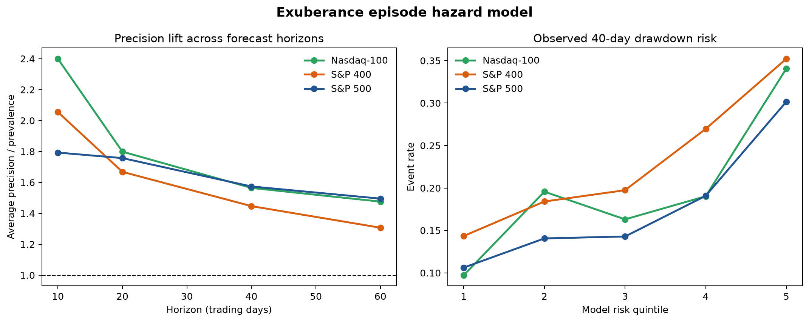

# Exuberance episode hazard model

## What changed from the original project

The original notebooks contained a worthwhile research intuition: unusually strong, smooth price appreciation combined with abnormal volume can describe a speculative buildup, and some buildups end in a sharp break. The original implementation could not support an early-warning claim because it confirmed an entire “bubble” episode only after observing its later crash, then trained models on labels that included the already-observed episode and burst.

Version 0.9 preserves the economic idea and corrects the timing:

1. **Exuberance onset:** identify the first day a stock has gained at least 20% in 60 trading days, remains within 10% of its 60-day high, and has not qualified during the prior 20 trading days.
2. **Forward hazard:** using only information available on that onset date, estimate the conditional chance of a 15% loss during days 1–10, 11–20, 21–40, and 41–60.
3. **Term structure:** combine the interval hazards into monotonic probabilities of a drawdown by 10, 20, 40, and 60 trading days.

This changes the unit of analysis from thousands of overlapping stock-days to one investable decision per new exuberance episode.

## Frozen design and status

The exact onset rule, outcome, horizons, 31 point-in-time features, regularization, training period, and evaluation universes were committed before the results were generated. The implementation was also committed before execution. However, the 2020–2026 periods had already been examined in earlier project versions, so this is an **exploratory model redesign**, not a second untouched holdout.

- Legacy training episodes: **2,696**
- Legacy 60-day drawdown events: **363**
- Evaluation episodes across three universes: **8,464**
- Evaluation period: 2020-01-01 through the last onset with a complete 60-day outcome window on 2026-07-07
- Model: one L2-regularized pooled discrete-time logistic hazard model
- Hyperparameter search: none; `C = 0.01` was inherited from the earlier legacy validation

## Results

### Primary 40-trading-day horizon

| Universe | Episodes | Events | ROC AUC | AP lift | Top-quintile event rate | Bottom-quintile event rate | Risk ratio | Run-up-only AUC |
|---|---:|---:|---:|---:|---:|---:|---:|---:|
| S&P 500 | 4,093 | 722 | 0.628 | 1.57× | 30.16% | 10.62% | 2.84× | 0.547 |
| Nasdaq-100 | 922 | 182 | 0.625 | 1.56× | 34.05% | 9.73% | 3.50× | 0.530 |
| S&P 400 | 3,449 | 791 | 0.618 | 1.45× | 35.22% | 14.35% | 2.45× | 0.538 |

The median signal-to-breach lead time among true events in the highest-risk quintile was **19 trading days** in the S&P 500 and Nasdaq-100 and **18 trading days** in the S&P 400.

The model beat trailing 60-day return alone in every universe. At 40 days, the run-up benchmark produced only 1.09×–1.17× average-precision lift, compared with 1.45×–1.57× for the hazard model. This matters because it shows the model is learning fragility beyond “the stock went up a lot.”

### Horizon behavior

Average-precision lift remained above prevalence at every horizon and in every universe:

| Universe | 10 days | 20 days | 40 days | 60 days |
|---|---:|---:|---:|---:|
| S&P 500 | 1.79× | 1.76× | 1.57× | 1.49× |
| Nasdaq-100 | 2.40× | 1.80× | 1.56× | 1.48× |
| S&P 400 | 2.05× | 1.67× | 1.45× | 1.31× |

The declining lift is economically sensible: current market state is more informative about an imminent break than about an event three months away.



## What the model learned

The largest non-time effects were not a single technical indicator. Risk rose with cross-sectional dispersion, recent 60-day return, trailing volatility, and idiosyncratic volatility. It fell with strong recent market returns, broad market participation, and very long-run 120-day relative return. In plain language, a stock-level surge looked more fragile when it occurred in a divided or weakening market and carried more stock-specific volatility.

That pattern is more defensible than the original notebook’s manually confirmed bubble regions: the output is a forward conditional risk rank, and its drivers can be inspected directly through standardized coefficients.

## Important weakness: calibration drift

The model separates higher- from lower-risk episodes, but its absolute probabilities are too low in the newer period. For example, mean predicted 40-day risk was 8.98% in the S&P 500 versus a 17.64% observed event rate; in the S&P 400 it was 9.25% versus 22.93% observed.

This is consistent with a base-rate shift between the legacy training period and the modern evaluation period. It means:

- the model’s ordering is useful;
- “higher risk than another episode” is supported;
- the raw probability should not yet be interpreted literally; and
- any live use should add a frozen, walk-forward intercept recalibration rule using only outcomes available before each prediction date.

Recalibration is deliberately left for a new specification rather than retrofitted after seeing these results.

## Defensible claim

The result supports the following statement:

> Conditional on a newly detected exuberant run-up, point-in-time price, volume, liquidity, and market-regime information produces a transferable ranking of severe drawdown risk over multiple future horizons.

It does **not** establish fundamental overvaluation, identify every economic bubble, prove a profitable short strategy, or supersede the separate alpha research. The model is compelling as an early-warning and risk-research system.

## Reproduction

After the documented local data layers are present:

```bash
python scripts/run_exuberance_hazard.py
```

The command writes the summary, horizon metrics, calibration table, standardized coefficients, episode predictions, and publication figure under `reports/tables/` and `docs/figures/`.

