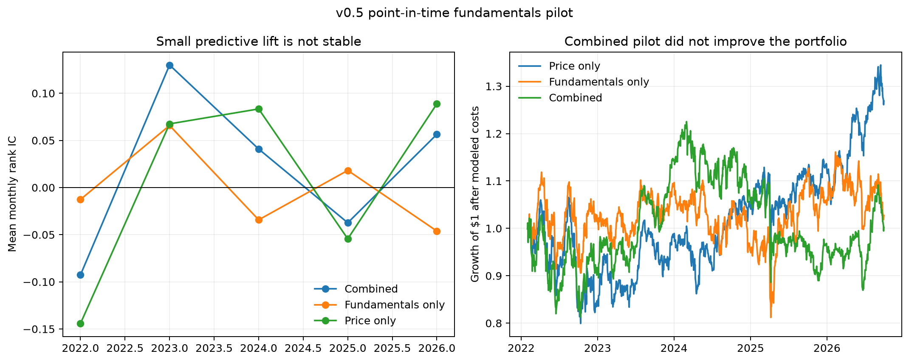

# Point-in-time fundamentals pilot results

## Verdict

The v0.5 pilot does **not** justify promoting fundamentals into the alpha candidate or scaling
this exact feature set. Adding the annual filing features raised pooled mean monthly rank IC from
0.0025 to 0.0168, but the paired improvement was only 0.0143 with a six-month block-bootstrap
interval of **[-0.0318, 0.0694]**. The lift was positive in three of five test years and therefore
was neither statistically distinguishable from zero nor stable across regimes.

This is a useful negative result. It was obtained from a specification frozen before model
evaluation and is not repaired after the fact through feature or parameter searching.

## Data and sample

- 22 deterministic pilot issuers, two from each current GICS sector
- Annual fiscal years 2018–2025
- 170 usable annual issuer-year records from 176 point-in-time responses
- 1,219 out-of-fold security-month observations
- 56 month-end cross-sections across 2022–2026
- Same beta-adjusted 21-trading-day target as the v0.3 alpha study

The direct SEC endpoint and bulk archive returned HTTP 403 from both the automated environment
and the project owner's normal Terminal. Before any result was observed, the pilot was amended to
use PtData's no-key point-in-time endpoint. The provider reports SEC Companyfacts as its upstream
source. Every raw response, source accession, and knowledge timestamp was retained locally. This
remains a third-party normalization dependency and is not described as a direct SEC download.

## Predictive comparison

| Model | Mean monthly rank IC | Block interval | Top-minus-bottom residual return |
|---|---:|---:|---:|
| Price only | 0.0025 | [-0.0712, 0.0803] | 0.59% |
| Fundamentals only | 0.0013 | [-0.0344, 0.0393] | 0.34% |
| Combined | 0.0168 | [-0.0342, 0.0752] | 0.83% |

The combined-minus-price IC delta was positive in 2022, 2023, and 2025, but negative in 2024
and 2026. Gross-margin and gross-profit-growth coverage was only 18.5%; most other signals had
75%–100% coverage.

## Diagnostic portfolios

The portfolios hold five of the 22 pilot names and charge 10 basis points per one-way trade.
They are highly concentrated and start from current constituents, so they are diagnostics—not
investable performance evidence.

| Model | Annual return | Volatility | Sharpe | Maximum drawdown | Six-factor alpha | HAC t-stat |
|---|---:|---:|---:|---:|---:|---:|
| Price only | 5.25% | 19.57% | 0.27 | -24.97% | -3.60% | -0.62 |
| Fundamentals only | 0.58% | 20.06% | 0.03 | -27.40% | -7.24% | -1.28 |
| Combined | 0.04% | 20.44% | 0.00 | -29.04% | -7.60% | -1.27 |

The predictive lift did not translate into a better concentrated portfolio. The combined model
therefore fails the practical robustness check even though portfolio return was not the formal
pass condition.

## Interpretation and next decision

Annual margins and growth rates are slow-moving and provided little independent short-horizon
information in this small sample. The appropriate response is not to search more combinations on
the same observations. The project should preserve this as a disciplined research branch and keep
the previously frozen ridge top-50 strategy as the only prospective alpha candidate.

If fundamentals are revisited later, the defensible new experiment would require a much larger
historical universe, quarterly filing updates, sector-neutral testing, and an independent frozen
evaluation period. It should not be undertaken merely to make the backtest look better.
