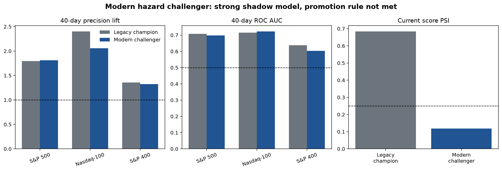
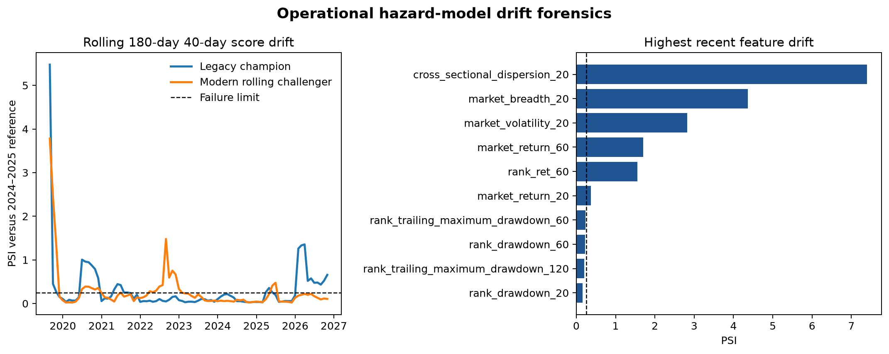

# Modern hazard challenger and drift forensics

## Result

Version 1.1 produced a strong operational challenger but did **not** authorize promotion. The
prewritten 2025 selection rule chose the three-year modern rolling model over the five-year
expanding model. On mature 2026 S&P 500 episodes, the selected challenger reduced current score PSI
from **0.684 to 0.118** while preserving useful risk ranking:

| Model | ROC AUC | Precision lift | Brier score | Top/bottom risk ratio | Current score PSI |
|---|---:|---:|---:|---:|---:|
| Active legacy champion | 0.709 | 1.796× | 0.155 | 6.40× | 0.684 |
| Modern rolling challenger | 0.699 | 1.810× | 0.152 | 7.25× | 0.118 |

The challenger passed the ROC floor, maximum ROC decline, absolute precision-lift floor, Brier,
drift, and both transfer-universe requirements. It failed one deliberately demanding rule: its
S&P 500 precision lift improved by only **0.014×**, below the required **0.05×** improvement.
Changing that threshold after observing the result would invalidate the release process, so the
legacy model remains active and the challenger remains shadow-only.

## Frozen selection

Both candidates used the existing 31-feature pooled logistic hazard, fixed `C=0.01`, identical
10/20/40/60-day intervals, and the unchanged exuberance-onset definition. The candidates differed
only in training history:

| Candidate | Training period | Episodes | 2025 ROC AUC | 2025 precision lift | 2025 Brier |
|---|---|---:|---:|---:|---:|
| Modern expanding | 2020–2024 | 3,238 | 0.613 | 1.678× | 0.120 |
| Modern rolling | 2022–2024 | 1,692 | 0.638 | 1.680× | 0.117 |

The rolling candidate won on the frozen primary metric, with ROC AUC as the tie-breaker.

## 2026 transfer diagnostics

| Universe | Episodes | Events | Challenger ROC AUC | Challenger precision lift | Champion precision lift |
|---|---:|---:|---:|---:|---:|
| S&P 500 | 394 | 80 | 0.699 | 1.810× | 1.796× |
| Nasdaq-100 | 73 | 12 | 0.723 | 2.057× | 2.401× |
| S&P 400 | 344 | 97 | 0.603 | 1.326× | 1.359× |

Both transfer universes passed the challenger’s frozen absolute floors. The champion remained
stronger on transfer precision lift, another reason not to present the challenger as a universal
replacement. The Nasdaq-100 result is also based on only 73 episodes and should not be overstated.

## Drift diagnosis

The evidence points to market-regime change and legacy-model aging rather than a broken refresh:

- the refreshed panel contains one consistent adjusted Alpaca SIP feed;
- current-member price coverage is 100%;
- 335 recent episode onsets are available for monitoring;
- four of the five highest-PSI variables are market-wide state variables;
- 20-day cross-sectional dispersion has PSI **7.40** and a standardized mean shift of **+2.57**;
- the modern rolling fit reduces output-score PSI by approximately **83%** without changing the
  feature or event definitions.

This is evidence consistent with regime shift, not proof of a single causal mechanism. PSI detects
distribution change; it does not by itself identify why markets changed.

## Shadow deployment

The selected model is stored as an immutable `SHADOW` registry artifact. Each scheduled run now:

1. keeps the legacy champion as the only model capable of authorizing signals;
2. scores the shadow model on the same episode onsets;
3. records `shadow_signals.csv`, the shadow artifact ID, and shadow score PSI;
4. excludes shadow output from trading or signal authorization;
5. retains byte-identical rerun behavior.

The first shadow run observed one October 23 onset, LDOS, with a 40-day shadow risk of 0.285. This
is a retained model observation, not a recommendation or an authorized production signal.

## Interpretation

The worthwhile result is not “a newer model always wins.” It is that a deliberately constrained
modern challenger repaired operational stability while preserving substantial ranking power, yet
the governance rule still prevented automatic promotion when incremental predictive improvement
was too small. That is a stronger quant-development story than silently replacing the model or
loosening the drift threshold.
