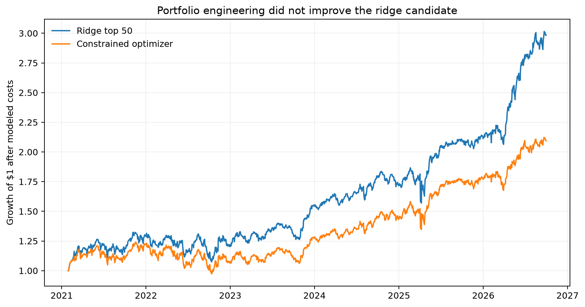

# Ridge portfolio-engineering results

## Verdict

The pre-specified v0.6 optimizer failed every pass condition. It modestly reduced annualized
volatility, but diluted the ridge return signal, increased turnover, worsened maximum drawdown,
and reduced the factor-alpha estimate to approximately zero. The frozen equal-weight top-50
portfolio remains the preferred candidate.

## Matched comparison

Both portfolios use the same out-of-fold ridge scores, dates, price panel, and 10-basis-point
one-way cost assumption.

| Metric | Ridge top 50 | Constrained optimizer |
|---|---:|---:|
| Annualized return | 21.34% | 13.97% |
| Annualized volatility | 17.94% | 17.26% |
| Sharpe ratio | 1.19 | 0.81 |
| Maximum drawdown | -18.83% | -21.49% |
| Annualized turnover | 13.49× | 14.19× |
| Six-factor alpha | 5.48% | -0.23% |
| Alpha HAC t-statistic | 1.46 | -0.06 |
| Market beta | 0.88 | 0.88 |

The optimizer held an average of 37.6 stocks and had average ex-ante beta of 0.86. Its risk model
did what it was asked to do only narrowly: estimated volatility fell, and realized volatility
declined by 0.68 percentage points. The cost was a 7.37-percentage-point reduction in annualized
return and a worse realized drawdown.

## Pass rule

- Sharpe improved: **No**
- Maximum drawdown improved: **No**
- Return remained within two percentage points of the baseline: **No**
- Factor alpha remained positive: **No**

No parameter was changed after observing these results. Trying alternative penalties now would
turn a portfolio-engineering test into a search over the same historical sample.

## Interpretation

The simple top-50 rule diversified the ridge signal better than the optimizer's combination of
score concentration, covariance estimates, and turnover control. In a modest historical sample,
estimated covariance is noisy and the additional constraints do not manufacture alpha.

This negative result strengthens the choice of the simpler prospective candidate. The production
research path is now intentionally conservative: preserve the top-50 specification, record future
signals immutably, and judge it on data unavailable when the candidate was selected.
