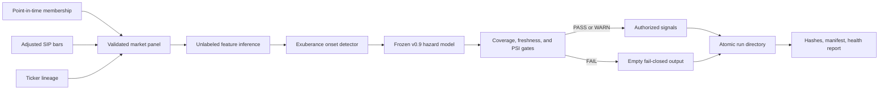

# Production drawdown-risk pipeline

## Purpose

The research pipeline originally required a complete future outcome window, which is correct for evaluation but makes true inference impossible. The production layer separates those concerns: it can create features and episode-onset scores for the newest market date without inventing a target, while the historical research builders retain their strict forward-label requirements by default.

This is a research-grade batch system, not an order-execution service. It creates monitored risk signals and immutable evidence; it does not place trades.

## Architecture



## Operational controls

Every run records:

- requested cutoff and actual market-data date;
- exact Git revision and pipeline/model versions;
- SHA-256 hashes of every market-data, membership, and alias input;
- a SHA-256 feature-schema fingerprint;
- training cutoff, feature count, and signal count;
- price coverage, history length, staleness, and recent episode volume;
- score PSI plus median, maximum, and top feature PSI values;
- hashes binding the signal file and health report to the manifest.

Hard failures suppress all signals and return a nonzero process status. Warning-level drift is preserved in the health report but does not suppress output. Run publication uses a temporary directory followed by an atomic rename, so downstream readers never see a partially written run.

The run identifier includes the universe, market date, pipeline version, and Git revision. Repeating an identical run verifies all bytes and reports an idempotent retry. A different payload at the same identity raises an error rather than overwriting evidence.

## Monitoring policy

The fixed operating reference is 2024-01-01 through 2025-12-31, a modern period already accepted during model validation. The recent comparison window is 180 calendar days.

| Check | Warning/failure behavior |
|---|---|
| Trading history | Fail below 180 observations |
| Latest member price coverage | Fail below 95% |
| Market-data staleness | Fail above four calendar days |
| Recent episode count | Fail below 25 |
| PSI | Warn above 0.10; fail when score or median feature PSI exceeds 0.25 |

An isolated feature can warn without suppressing the run; broad feature drift or output-score drift fails closed.

## Running the pipeline

```bash
python scripts/run_daily_risk_pipeline.py --universe sp500 --as-of 2025-12-26
python scripts/run_daily_risk_pipeline.py --universe ndx --as-of 2025-12-26
python scripts/run_daily_risk_pipeline.py --universe sp400 --as-of 2025-12-26
```

Omit `--as-of` to request the newest locally available market date. The configured four-day staleness gate prevents an old local snapshot from being presented as current.

Outputs are written under:

```text
reports/operations/risk_signals/<run-id>/
├── health.json
├── manifest.json
└── signals.csv
```

The generated directory is intentionally excluded from Git because it contains dated operational evidence tied to locally licensed data.

## Verified operating examples

| Universe/date | Status | Authorized signals | Behavior |
|---|---|---:|---|
| S&P 500 / 2025-12-26 | WARN | 1 | Emitted UAL’s monotonic 10/20/40/60-day risk curve; exact rerun was idempotent |
| Nasdaq-100 / 2025-12-26 | WARN | 0 | Healthy run with no new episode onset that day |
| S&P 400 / 2025-12-26 | WARN | 2 | Emitted two new episode-onset records |
| S&P 500 / 2026-09-30 | FAIL | 0 | Suppressed output after score PSI reached 0.521 versus the 0.25 failure threshold |

The 2026 failure is not retroactively “fixed.” It demonstrates intended production behavior: good coverage and fresh data are insufficient when the live score distribution has moved outside the accepted operating envelope.

## Interpretation

The emitted values are relative fragility scores from the frozen v0.9 model. The calibration study showed that their absolute levels should not be treated as literal probabilities. Operational monitoring therefore focuses on reproducibility, ranking stability, and distribution shift rather than presenting the output as trading advice.

