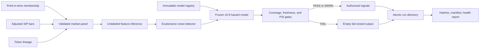

# Production drawdown-risk pipeline

## Purpose

The research pipeline originally required a complete future outcome window, which is correct for evaluation but makes true inference impossible. The production layer separates those concerns: it can create features and episode-onset scores for the newest market date without inventing a target, while the historical research builders retain their strict forward-label requirements by default.

This is a research-grade batch system, not an order-execution service. It creates monitored risk signals and immutable evidence; it does not place trades.

## Architecture



## Operational controls

Every run records:

- requested cutoff and actual market-data date;
- exact Git revision and pipeline/model versions;
- SHA-256 hashes of every market-data, membership, and alias input;
- a SHA-256 feature-schema fingerprint;
- training cutoff, feature count, and signal count;
- price coverage, history length, staleness, and recent episode volume;
- score PSI plus median, maximum, and top feature PSI values;
- hashes binding the signal file and health report to the manifest.

Training is a separate, explicit operation. It produces an immutable `joblib` artifact plus
strict JSON metadata containing the training-data/config hashes, feature schema, horizons,
training cutoff, code revision, and model checksum. Daily inference loads only the artifact named
by the atomic `ACTIVE` pointer and verifies its checksum and schema before scoring.

Hard failures suppress all signals and return a nonzero process status. Warning-level drift is preserved in the health report but does not suppress output. Run publication uses a temporary directory followed by an atomic rename, so downstream readers never see a partially written run.

The run identifier includes the universe, market date, pipeline version, Git revision, active
model identity, and source-data fingerprint. Repeating an identical run verifies all bytes and
reports an idempotent retry. A different payload at the same identity raises an error rather than
overwriting evidence.

## Monitoring policy

The fixed operating reference is 2024-01-01 through 2025-12-31, a modern period already accepted during model validation. The recent comparison window is 180 calendar days.

| Check | Warning/failure behavior |
|---|---|
| Trading history | Fail below 180 observations |
| Latest member price coverage | Fail below 95% |
| Market-data staleness | Fail above four calendar days |
| Recent episode count | Fail below 25 |
| PSI | Warn above 0.10; fail when score or median feature PSI exceeds 0.25 |

An isolated feature can warn without suppressing the run; broad feature drift or output-score drift fails closed.

## Running the pipeline

Register and activate the frozen model once (or whenever a deliberately versioned replacement is
approved):

```bash
python scripts/register_hazard_model.py --activate
```

Then run inference:

```bash
python scripts/run_daily_risk_pipeline.py --universe sp500 --as-of 2025-12-26
python scripts/run_daily_risk_pipeline.py --universe ndx --as-of 2025-12-26
python scripts/run_daily_risk_pipeline.py --universe sp400 --as-of 2025-12-26
```

Omit `--as-of` for a real daily run. The requested cutoff becomes the actual current date, while
the newest local observation remains the market-data date. Their difference drives the four-day
staleness gate. Use `--as-of` only for an explicit historical replay.

Outputs are written under:

```text
reports/operations/risk_signals/<run-id>/
├── health.json
├── manifest.json
└── signals.csv
```

Registered models are stored separately under `reports/operations/model_registry/`. Both generated
locations are excluded from Git because they contain local artifacts tied to non-redistributable
inputs.

CI runs a credential-free synthetic integration test through feature construction, immutable model
registration/loading, inference, health gates, and atomic publication. Unit tests also verify
checksum tamper detection, strict JSON serialization, staleness blocking, and idempotent retries.

## Refresh and scheduling

The operational S&P 500 refresh uses the existing local Alpaca credentials and a 400-calendar-day
overlap window. It reconstructs membership through the requested date, downloads delayed SIP bars
through the latest completed day allowed by the free account, replaces the overlap, and validates
duplicates, schema, freshness, and current-member coverage before publishing. Bars, membership,
and membership reference tables are replaced as one rollback-capable transaction.

```bash
python scripts/refresh_sp500_operations.py
python scripts/run_scheduled_operations.py
```

The scheduler wrapper holds a non-blocking process lock, runs refresh before inference, retains a
strict JSON receipt for every attempt, and propagates nonzero failure status. On macOS it uses a
local notification by default. An HTTPS webhook can replace that local notification; the value
remains outside Git:

```text
RMM_ALERT_WEBHOOK_URL=https://your-private-webhook
```

On macOS, render a weekday 6:15 p.m. `launchd` definition with:

```bash
python scripts/render_macos_schedule.py
```

The generated plist is local operational output. Review it before copying it into
`~/Library/LaunchAgents/`; rendering does not silently enable a background job.

## Verified operating examples

| Universe/date | Status | Authorized signals | Behavior |
|---|---|---:|---|
| S&P 500 / 2025-12-26 | WARN | 1 | Emitted UAL’s monotonic 10/20/40/60-day risk curve; exact rerun was idempotent |
| Nasdaq-100 / 2025-12-26 | WARN | 0 | Healthy run with no new episode onset that day |
| S&P 400 / 2025-12-26 | WARN | 2 | Emitted two new episode-onset records |
| S&P 500 / 2026-09-30 | FAIL | 0 | Suppressed output after score PSI reached 0.521 versus the 0.25 failure threshold |
| S&P 500 / 2026-10-23 | FAIL | 0 | Fresh, complete input passed every data gate, but score PSI reached 0.684; output remained suppressed |

The 2026 failures are not retroactively “fixed.” The October refresh is especially informative:
100% current-member coverage and acceptable three-day weekend staleness were not enough to bypass
model-health controls. Fresh data and a healthy model are deliberately separate requirements.

## Interpretation

The emitted values are relative fragility scores from the frozen v0.9 model. The calibration study showed that their absolute levels should not be treated as literal probabilities. Operational monitoring therefore focuses on reproducibility, ranking stability, and distribution shift rather than presenting the output as trading advice.

