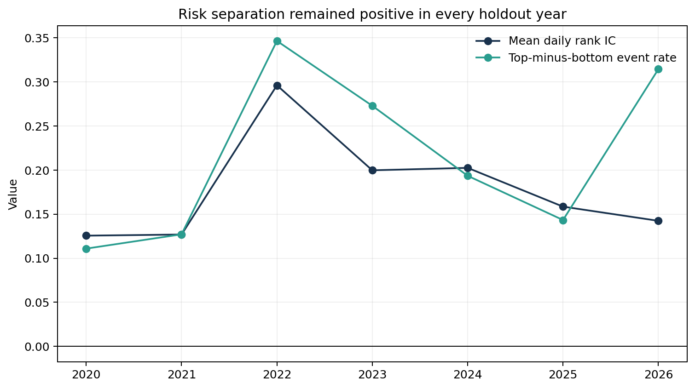
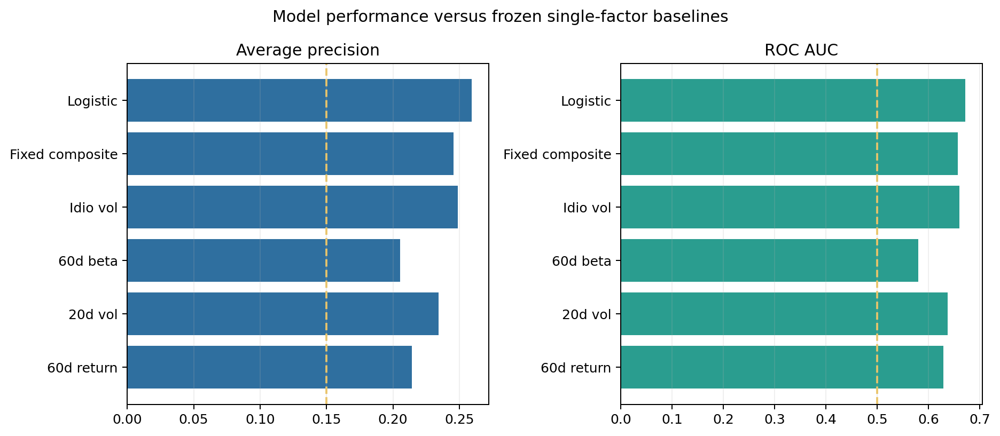
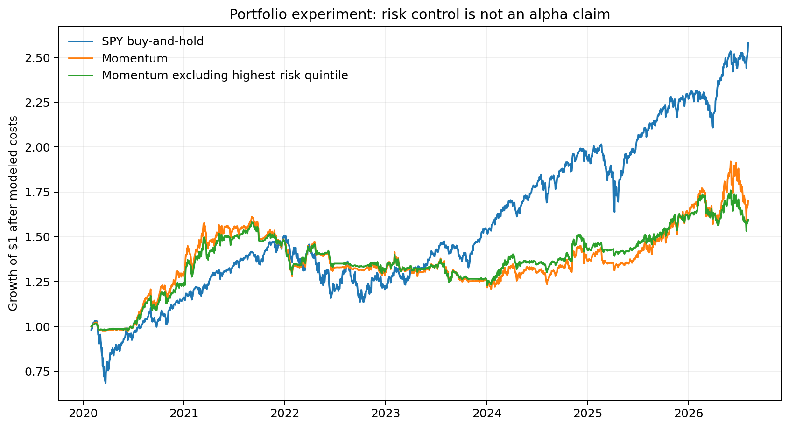

# Results

## Executive conclusion

The project found a repeatable cross-sectional drawdown-risk signal, not a standalone
trading edge. In the untouched 2020–2026 replication, the logistic model ranked severe
40-trading-day drawdowns materially better than chance and retained positive separation in
every calendar year. A frozen, simple factor composite remained competitive, showing that
the project benefits more from careful data and validation than from model complexity.

The portfolio experiment did not support an alpha claim. Validation selected a zero weight
on the risk penalty. A separate monthly exclusion rule reduced volatility, beta, and maximum
drawdown, but also reduced return and average market exposure. SPY buy-and-hold outperformed
all experimental strategies over this particular period.

## Modern holdout

The model was selected on 2012–2016 data, checked on a 2017–2019 legacy test, refit on the
three frozen legacy samples, and evaluated once on point-in-time S&P 500 membership from
2020 onward. The modern sample contains 91,299 eligible stock-date observations through the
last signal date with a complete 40-day outcome window, 2026-08-04.

| Metric | Modern result |
|---|---:|
| Drawdown-event prevalence | 14.99% |
| Average precision | 25.93% |
| Average-precision lift | 1.73× |
| ROC AUC | 0.671 |
| Mean daily rank IC | 0.178 |
| 40-day block-bootstrap IC interval | [0.126, 0.226] |
| Highest-risk-decile event rate | 26.28% |
| Lowest-risk-decile event rate | 7.44% |
| Top-minus-bottom spread | 18.84 percentage points |
| Top-to-bottom risk ratio | 3.53× |

Risk separation was positive in every calendar year from 2020 through the partial 2026
sample. Performance weakened in 2021 but did not reverse.

## Baselines and model complexity

The logistic model achieved the strongest average precision and ROC AUC among the frozen
comparisons. However, the fixed rank composite achieved slightly stronger mean rank IC and
decile spread. Idiosyncratic volatility was also a strong single-factor baseline.

This means the multivariate model adds useful classification information, but the evidence
does not justify claiming that machine-learning complexity is essential.

## Portfolio experiment

Portfolios use a 2% maximum position weight and 10 basis points of one-way trading cost.
Risk-penalty strength was selected only on the 2016 validation interval. Validation selected
zero for both weekly and monthly risk-adjusted portfolios, so those portfolios reduce to the
ordinary momentum baseline.

| Monthly strategy | Annual return | Volatility | Sharpe (0% rate) | Max drawdown | SPY beta | Avg. invested |
|---|---:|---:|---:|---:|---:|---:|
| Momentum | 8.54% | 15.44% | 0.553 | -24.97% | 0.392 | 67.70% |
| Exclude highest-risk quintile | 7.47% | 12.43% | 0.601 | -22.17% | 0.301 | 61.02% |
| SPY buy-and-hold | 15.73% | 20.01% | 0.786 | -33.79% | 1.000 | 100.00% |

The exclusion rule is best interpreted as a defensive overlay. Part of its volatility and
drawdown reduction comes from holding more cash, so it is not clean evidence of superior
security selection. Weekly filtering reduced risk but worsened Sharpe. These caveats are
part of the result, not hidden implementation details.

## Data-quality findings

- The Alpaca overlap pilot matched all 20 requested ordinary and difficult securities.
- Median return correlation with the legacy source exceeded 0.999.
- The expanded download contains 1,101,390 bars across 642 returned symbols.
- Daily membership was reconstructed by reversing 412 constituent changes rather than
  backfilling the current index.
- Dated mappings handle ticker changes and reuse, including the unrelated reuse of `STI`.
- Median price coverage during membership is 100%; only `RHT`, a short-lived edge case, is
  below 95%.

## Limitations

- Public constituent-change history is a practical point-in-time proxy, not a licensed
  institutional security master.
- Historical point-in-time sector classifications were not available from the chosen free
  sources, so the portfolio does not claim sector neutrality.
- The model uses daily bars only and excludes fundamentals, options, news, and intraday data.
- Transaction costs are modeled, but market impact, borrow constraints, taxes, and live
  execution are not.
- The drawdown target produces overlapping observations; moving-block inference addresses
  serial dependence but does not make them independent events.
- Results are research evidence, not investment advice.
